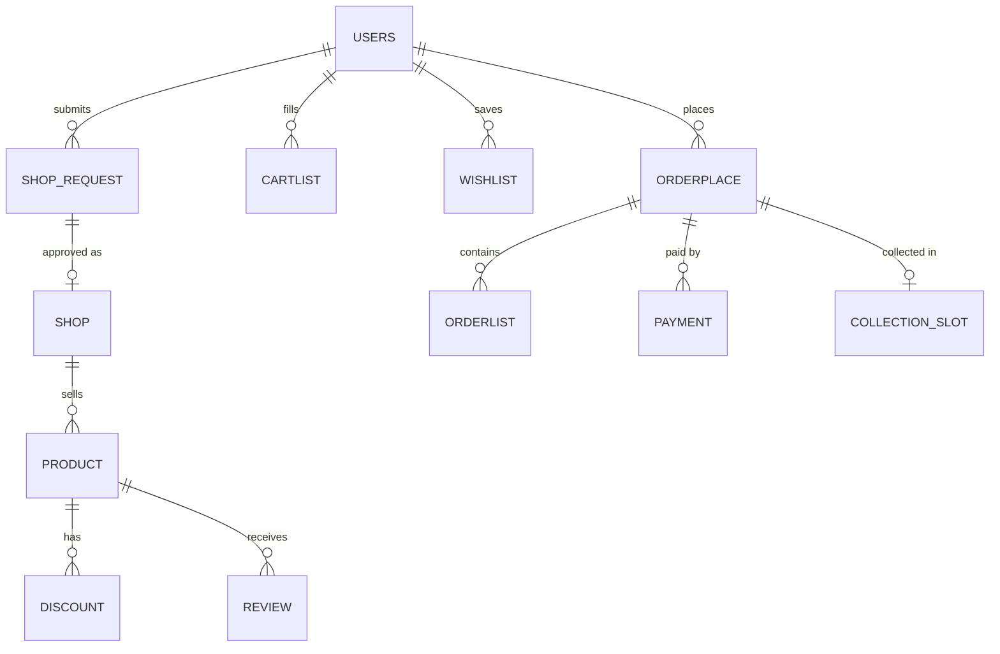

# GrocerEase

GrocerEase is a multi-vendor grocery marketplace: one platform where many local traders sell together, with PayPal checkout, collection-slot booking and email OTP verification. Customers browse products from several independent shops, keep a cart and wishlist, book a collection slot and pay through PayPal (sandbox). Traders apply to open a shop and then manage their own products, discounts and orders. It was built as a team project in PHP on Oracle Database, with Oracle APEX applications for traders and administrators.

## Features

- Customer accounts with registration, login, email OTP verification and a forgotten-password reset flow (emails sent with PHPMailer over SMTP).
- Trader onboarding: a trader registers a shop request, an administrator approves it, and the trader is notified by email.
- Product discovery: listing, product detail pages, category filters, search (including a separate mobile search) and a top-deals page driven by product discounts.
- Cart and wishlist stored in the database per user.
- Checkout with a collection slot (day, time window and date), followed by PayPal sandbox payment with success and failure pages.
- Order history, invoices and product reviews with star ratings.
- Trader pages for managing products, discounts and orders awaiting delivery.
- Oracle APEX applications for traders (application 103, "Trader") and administrators (application 104, "Admin App").

## Architecture

Server-rendered PHP pages talk to Oracle Database through the OCI8 extension. Reusable page parts (navigation bars, footers, page sections) live in `components/`. Email goes out through PHPMailer; payment is handed to PayPal's sandbox checkout and returns to `success-page.php` or `error-page.php`.

Core tables, from the schema script `GrocerEaseProject/Scipt FILE.txt`:



The script also creates `ADVERTISEMENT` and `REPORT` tables, plus one sequence and one insert trigger per table for primary keys.

## Tech stack

| Layer | Technology |
|---|---|
| Front end | HTML, CSS, JavaScript |
| Back end | PHP with session-based authentication |
| Database | Oracle Database XE via OCI8 |
| Admin and trader dashboards | Oracle APEX (exports from APEX 19.2) |
| Payments | PayPal Standard Checkout (sandbox) |
| Email | PHPMailer (SMTP) |
| Server | Apache (XAMPP) |

## Getting started

### Prerequisites

- XAMPP (Apache and PHP) with the `oci8` extension enabled in `php.ini`
- Oracle Database XE, and Oracle APEX if you want the trader and admin dashboards
- A PayPal Developer sandbox account
- An SMTP account (the mail scripts use Gmail on port 587 with TLS)

### Environment variables

Secrets are read from the environment, not from the code.

| Variable | Used in | Purpose | Default |
|---|---|---|---|
| `DB_USER` | `connection.php` | Oracle schema user | `GROCEREASE1` |
| `DB_PASS` | `connection.php` | Oracle schema password | empty |
| `DB_DSN` | `connection.php` | Oracle connect string | `localhost/XE` |
| `SMTP_PASSWORD` | `PHPMailer/*.php` | SMTP password (an app password for Gmail) | none |

With XAMPP, set them in the Apache configuration, for example `SetEnv DB_PASS your_password` in `httpd.conf`, then restart Apache.

### Install and run

1. Clone into the web root:
   ```bash
   cd /Applications/XAMPP/htdocs   # C:/xampp/htdocs on Windows
   git clone https://github.com/Sabin78910/GrocerEase.git
   ```
2. Create an Oracle user (for example `GROCEREASE1`) and run `GrocerEaseProject/Scipt FILE.txt` as that user in SQL Developer or SQL*Plus. The script starts by dropping existing objects, so those first statements fail harmlessly on an empty schema.
3. Optional: import `GrocerEaseProject/f103.sql` (Trader) and `GrocerEaseProject/f104.sql` (Admin App) in APEX App Builder.
4. Set the environment variables above. The sender address is set in the scripts in `PHPMailer/`.
5. In `checkout.php`, set the PayPal sandbox `business` address and change the `return` and `cancel_return` URLs to your local path (they currently point to `http://localhost/TapBasket/`).
6. Start Apache and open `http://localhost/GrocerEase`.

## Project structure

| Path | Contents |
|---|---|
| `*.php` (root) | Page controllers: home, product, filter, cart, wishlist, checkout, orders, invoice, registration, OTP, trader pages |
| `components/` | Reusable navigation bars, footers and page sections |
| `assets/` | Stylesheets (base, components, pages, themes) and images |
| `js/`, `app.js`, `theme.js`, `banner.js` | Client-side scripts, including theme switching |
| `PHPMailer/` | Mail scripts for OTP, trader and admin notifications, with the vendored PHPMailer library |
| `ProductImage/` | Product images |
| `GrocerEaseProject/` | The team's project folder: a second copy of the site, the Oracle schema script and the APEX exports |

## Security notes

- Database and SMTP passwords come from environment variables (`DB_PASS`, `SMTP_PASSWORD`). An earlier database password remains in git history, so it must be changed on any database that used it.
- Product, order, user and shop IDs and quantities taken from `$_GET` and `$_POST` are cast to integers before use. Search and category text has single quotes doubled before it reaches SQL, and many queries use OCI8 bind variables.
- Request values echoed back into pages are escaped with `htmlspecialchars()` to prevent reflected XSS.
- Known gap: passwords are stored as unsalted MD5 hashes. They should move to `password_hash()` and `password_verify()`.

## Design decisions and limitations

- Plain PHP pages with no framework: simple to run on XAMPP, but routing, validation and templates are repeated per page.
- Not every query uses bind variables yet; some still build SQL from cast or escaped values.
- A paid order is recorded from PayPal's return URL rather than verified with IPN or a webhook, so the payment status is not independently confirmed.
- The site exists twice (repository root and `GrocerEaseProject/`), so fixes must be applied to both copies.
- There are no automated tests or CI.

## Author

**Sabin Khanal**. [Portfolio](https://sabinkhanal13.com.np) · [LinkedIn](https://www.linkedin.com/in/sabin-khanal-950163326) · [GitHub](https://github.com/Sabin78910)
